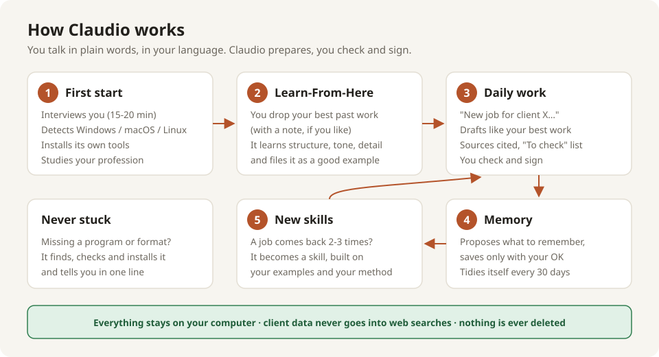
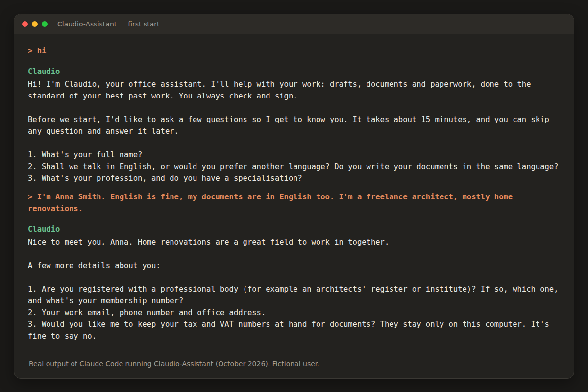
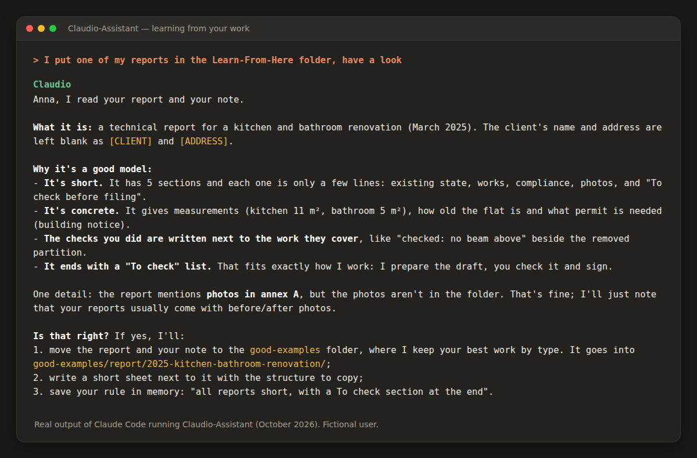

# Claudio-Assistant

**English** · [Italiano](README.it.md) · [Français](README.fr.md) · [Deutsch](README.de.md)

A ready-made folder for [Claude Code](https://claude.com/claude-code) that turns Claude into
**Claudio**, a highly autonomous office assistant for professionals who are not programmers.
It learns how *you* work from the examples you give it, remembers what matters, installs
its own tools and always hands you **drafts** that you check and sign.

## Who it is for

Any professional or small office: lawyers, accountants, architects, surveyors, engineers,
consultants, doctors, translators… on **Windows, macOS or Linux**. No technical skills
are needed: you talk to Claudio in plain words, in your own language.

## Key features

- **First-start interview.** Claudio asks who you are, what you do, where you keep your files,
  which programs you use and how you like to work (15-20 minutes, one question at a time).
- **Studies your profession** on official sources and proposes the list of your typical jobs.
- **Installs its own tools** (reading and writing Word, Excel, PDF, scans, web browsing): you
  only click "Yes" when the system asks for permission.
- **Learns from your best work.** Drop finished documents into the `Learn-From-Here` folder
  (there is a shortcut on your desktop): Claudio studies them and uses them as the quality
  benchmark.
- **Local memory that tidies itself.** Clients, suppliers, authorities, decisions and lessons
  are kept in plain text files inside the folder. Every 30 days Claudio proposes a tidy-up:
  no duplicates, no contradictions, files split when they grow too long.
- **Asks before remembering.** Nothing is written into memory without your OK.
- **Creates new skills.** When a type of job comes back for the 2nd or 3rd time, Claudio
  proposes turning it into a skill, built on your examples and your method.
- **Privacy first.** Client data stays on your computer and is never typed into websites
  or web searches.
- **Drafts, never final documents.** Every document ends with a "To check" list. Data, prices
  and laws are taken from a source and cited; if there is no source, Claudio says so.
- **Does not always agree with you.** If a request is wrong, Claudio explains why, with the
  source, and proposes alternatives. You decide.

## How it works



1. **First start.** You open the folder in Claude Code and say "hi". A startup script tells
   Claude that setup is needed: Claudio interviews you, installs the basic toolkit and studies
   your profession (internet required).
2. **Teaching it.** Put 2-3 good past works into `Learn-From-Here` and tell Claudio. It
   works out what kind of job each one is, files them under `good-examples/` and updates
   memory.
3. **Daily work.** Ask in words: "new job for client X", "prepare the report like last time".
   Every job gets its own card (`jobs/<job>/JOB.md`) with who, what, status, decisions
   and where the files are. You can also work in a folder of your own: Claudio backs it up first.
4. **At the end of a job** Claudio proposes the 2-5 things worth remembering and saves them
   only if you agree.
5. **Every 30 days** it proposes tidying up memory and skills, and a backup copy.

## See it in action

Real output of Claude Code running this folder (fictional user).





## Folder structure

```
Claudio-Assistant/
├── CLAUDE.md                the assistant's rules (read by Claude at every start)
├── README.md                this page (also .it .fr .de)
├── GETTING-STARTED.en.txt   short install guide (also .it .fr .de)
├── CUSTOMIZING.md           for whoever prepares the folder for a profession
├── LICENSE
├── docs/                    user manual: MANUAL.en.html, MANUAL.it.html, MANUAL.fr.html, MANUAL.de.html
├── memory/                  what Claudio knows: you, the office, the profession, contacts, decisions, lessons
│   ├── INDEX.md
│   ├── office/              owner.md, office.md, tools.md
│   ├── contacts/            clients.md, suppliers.md, authorities.md
│   ├── decisions/           preferences.md, privacy.md
│   ├── lessons/             lessons.md
│   ├── profession.md, job-types.md, _maintenance.md
│   └── _history/            old versions kept by the tidy-up
├── jobs/                    one subfolder per job, each with its JOB.md
│   ├── _template/           JOB.md template
│   ├── _backup/             copies made before working in your own folders
│   └── _archived/
├── good-examples/           your best work, by type: the quality benchmark
├── Learn-From-Here/         the inbox where you drop work for Claudio to study
├── knowledge/               your profession's sources (laws, price lists, forms)
├── _trash/                  nothing is deleted: removed files wait here for you
└── .claude/
    ├── settings.json
    ├── hooks/               startup.ps1 (Windows), startup.sh (macOS/Linux)
    └── skills/              help, setup, new-job, learn-from-here, remember,
                             tidy-memory, archive, create-skill, forget, get-tools
```

The 10 skills can be called as commands (`/help`, `/setup`, `/new-job`…) or simply by asking
in words. Folder and skill names are in English so the package works everywhere; Claudio
explains them to you and writes memory in your language.

## Requirements

- A **Claude Pro plan or higher** (Max, Team, Enterprise).
- **Windows or macOS:** the [Claude Desktop app](https://claude.ai/download), **Code** tab.
- **Linux:** there is no official desktop app; use the
  [Claude Code CLI](https://docs.claude.com/en/docs/claude-code) in the terminal or the
  Claude Code extension for VS Code.
- **Internet** for the first setup (tool installation and study of the profession) and for
  normal use of Claude.

## Installation

### Option A — as a Claude Code plugin (quickest)

In Claude Code type:

```
/plugin marketplace add JoeBosi/Claudio-Assistant
/plugin install claudio-assistant@claudio-assistant
```

(On Claude Code 2.1.275 or later one line is enough:
`/plugin install claudio-assistant --marketplace JoeBosi/Claudio-Assistant`.)
Then just ask **"create my office assistant"** (or `/claudio-assistant:new-office`): Claudio
copies the ready-made folder where you choose and tells you how to open it.
Then continue from step 3 below.

### Option B — download the folder


1. **Download** the folder: on GitHub click *Code → Download ZIP* and unzip it, or
   `git clone https://github.com/JoeBosi/Claudio-Assistant.git`.
2. **Put it in a stable place**, e.g. `Documents/Claudio-Assistant`, and **do not move it
   later**: the chat history is tied to that path (memory is inside the folder and is not
   lost). If you want to rename it (e.g. `Lawyer-Claudio`), do it before the first start.
3. **Open it in Claude Code**: in the desktop app, *Code* tab, choose the folder as the working
   folder (on Linux: `cd` into the folder and run `claude`).
4. **Trust the folder** when asked: it is needed for the permissions and the startup script.
5. **Permission mode:** in the app choose **"Auto"** if available (Claude works on its own and
   asks only for risky actions); otherwise **"Accept edits"**. (Linux, Claude Code in the terminal:
   switch mode with Shift+Tab.)
6. **Say "hi".** Claudio introduces itself and starts the setup. Doing the first session
   together with the person who will use it is a good idea.

Step-by-step guides for the person installing it: `GETTING-STARTED.<language>.txt`.

## What the plugin does on your computer (transparency)

- **The plugin itself** contains one skill, `new-office`. It only copies the template files
  from the plugin folder into a new folder you choose (it never overwrites an existing one).
  It sends nothing anywhere, downloads nothing and changes no Claude settings.
- **The folder it creates** is a normal Claude Code project folder. It contains:
  - `.claude/settings.json`: **project-level** permission rules that apply only inside that
    folder. They pre-allow common office and installation commands (for example `winget`,
    `brew`, `pandoc`, `python`, copying and listing files, web search) and **deny**
    destructive ones (`rm`, `del`, `Remove-Item`, `shred`, `git clean`, `rsync --delete`…);
  - startup scripts (`.claude/hooks/startup.ps1` and `startup.sh`). They run locally at the
    start of each chat, read the memory files in the folder, count files in
    `Learn-From-Here/` and print short reminders for Claude. They make no network
    connection. They are enabled only at the first start, when the `setup` skill writes
    `.claude/settings.local.json` for your system;
  - Markdown instructions, skills and memory templates. Memory is written only to files
    inside the folder.
- **What Claudio does later, inside that folder** (all visible in the chat): it installs free
  programs it needs with the system's package manager (`winget`, Homebrew, `apt`…), searches
  the web and reads public websites (laws, official portals, product sheets), and never types
  client data into websites. Nothing is sent to any service other than Claude itself and the
  websites it reads.

## Privacy notes

Claudio is designed to keep client data local and never disclose it, but the conversation
itself goes through Anthropic's service. Before working with real client data:

- In Claude's settings, turn off the option that lets Anthropic use your chats to
  improve its models (Settings → Privacy).
- For client data, consider a **commercial plan** (Team / Enterprise / API) with a
  **Data Processing Agreement (DPA)**.
- Turn on **disk encryption** (BitLocker, FileVault, LUKS): memory is stored as plain text
  files on your computer.
- Talk to your **data-protection adviser** (e.g. under the GDPR in the EU) and check the rules
  of your professional body on AI use. Several laws make the professional responsible for
  AI-assisted work (e.g. the EU AI Act).

## Updating without losing memory

Your memory and work live in `memory/`, `jobs/`, `good-examples/`, `knowledge/` and in the
skills Claudio created for you. **Do not overwrite the folder** with a new version.
The simplest way: download the new version into a separate folder and tell Claudio
"there is an update in <folder>, merge it without losing my memory". It updates rules,
manuals and the standard skills and leaves your data alone.
Do not use `git pull` on a folder already in use: setup fills in the memory files, so a
pull would clash with your data.

## Customizing for a profession

Claudio adapts on its own at the first start. If you want to prepare it in advance for a
profession (sources in `knowledge/`, profession profile, ready-made skills), see
[CUSTOMIZING.md](CUSTOMIZING.md).

## Limitations and honest notes

- **Tested in real use:** the author installed Claudio on a real office computer with the
  Claude Desktop app (October 2026) and everything worked: setup, tool installation,
  learning from examples, memory.
- **Also tested:** `startup.sh` on Linux; `startup.ps1` with PowerShell 7. Feedback and issues
  on other systems and versions are welcome.
- Claude sometimes writes paths in the wrong format for the system (e.g. Linux-style paths on
  Windows). There is a rule against it in `CLAUDE.md`; keep an eye on it in the first sessions.
- The Anthropic **docx / pdf / xlsx / pptx** skills are **not included** because their licence
  does not allow redistribution. Claudio installs them (or free alternatives) automatically
  at the first start.
- "Auto" permission mode cannot be set from the project files: you choose it in the app.
- Claudio is an assistant: the documents it prepares are drafts. The professional checks them,
  signs them and stays responsible for them.

## Languages

README: [English](README.md) · [Italiano](README.it.md) · [Français](README.fr.md) · [Deutsch](README.de.md)
User manual: [English](docs/MANUAL.en.html) · [Italiano](docs/MANUAL.it.html) · [Français](docs/MANUAL.fr.html) · [Deutsch](docs/MANUAL.de.html)
Claudio talks to you in your own language, whatever it is.

## Origin

The package derives from a real assistant built for a surveyor's office in October 2026,
generalised for any profession.

## License

MIT — see [LICENSE](LICENSE).

The plugin icon includes the "flexed biceps" emoji from
[Google Noto Emoji](https://github.com/googlefonts/noto-emoji), Apache License 2.0.

## Author

Giuseppe Bosi — GitHub [@JoeBosi](https://github.com/JoeBosi)
